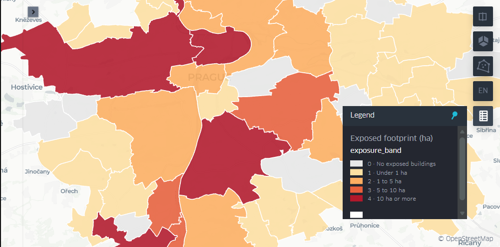
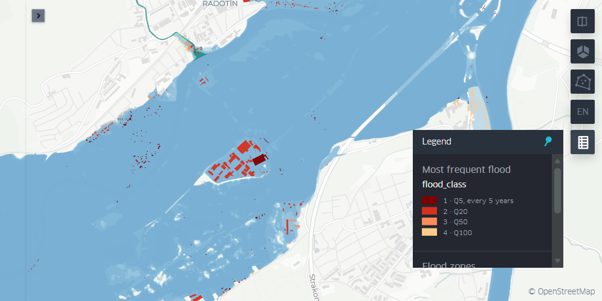
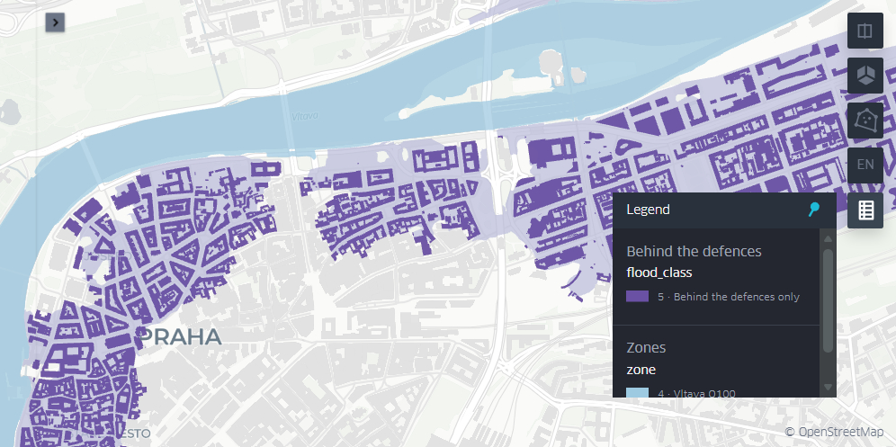

# Prague flood exposure: a distributed spatial join in Apache Sedona

> **Reproduced three ways, with identical results:** locally in Apache Sedona, on a
> Wherobots cluster (every one of the 163,092 output cells identical), and by an
> independent GeoPandas implementation (every building classified the same).

Which Prague buildings sit inside official flood zones, and which of the city's 57
districts (*městské části*) have the most exposed building stock? The pipeline answers
that with a distributed spatial join in [Apache Sedona](https://sedona.apache.org/)
on [Wherobots](https://wherobots.com/), exports clean GeoParquet tables, and draws
interactive kepler.gl maps of the results on Wherobots.

## Results

Of Prague's 208,621 buildings, **5,421 (2.6%) touch an official river or small-stream
flood zone** while the flood defences hold. That is 108.6 ha of building footprint.
**Behind the defences lie another 4,610 buildings with 181.4 ha of footprint**, which
flood only if the defences fail. Prague's flood exposure is mostly a question of whether
the barriers hold.

| Most frequent flood a building touches | Buildings | Footprint (ha) | Of which point inside zone | At least 30 m² |
|---|---:|---:|---:|---:|
| Q5 | 1,264 | 12.9 | 1,253 | 799 |
| Q20 | 1,454 | 36.3 | 1,448 | 1,032 |
| Q50 | 451 | 16.1 | 433 | 262 |
| Q100 | 2,252 | 43.2 | 1,575 | 1,623 |
| **Exposed, defences holding** | **5,421** | **108.6** | **4,709** | **3,716** |
| Residual: behind the defences only | 4,610 | 181.4 | n/a | 4,058 |

Districts ranked by exposed footprint (defences holding):

| Rank | District | Exposed footprint (ha) | Share of the district's footprint | Exposed buildings | Rank by count |
|---:|---|---:|---:|---:|---:|
| 1 | Praha 16 (Radotín) | 18.8 | 35% | 598 | 2 |
| 2 | Praha 7 | 14.2 | 12% | 297 | 7 |
| 3 | Praha 6 | 12.0 | 3% | 492 | 4 |
| 4 | Praha 4 | 10.2 | 3% | 310 | 6 |
| 5 | Praha-Zbraslav | 8.4 | 18% | 785 | 1 |
| 6 | Praha 10 | 7.5 | 2% | 250 | 9 |
| 7 | Praha-Lipence | 6.9 | 29% | 577 | 3 |
| 8 | Praha-Velká Chuchle | 5.5 | 25% | 237 | 10 |

Behind the defences, the order changes completely: **Praha 8 (61.2 ha), Praha 1
(49.5 ha) and Praha 7 (31.7 ha)** hold the most residual-risk footprint. These are the
central riverside districts, including Karlín (Praha 8), one of the areas worst hit by
the 2002 flood. 11 of the 57 districts have no exposed buildings at all.

## Maps

Three interactive maps, rendered on Wherobots with SedonaKepler (kepler.gl). The
screenshots below are from that run.

**Exposed building footprint by district, defences holding.** Praha 16, 6, 7 and 4 are
in the top band; 11 districts have no exposed buildings.



**Buildings in the flood zones, at the Vltava-Berounka confluence.** Each building is
coloured by the most frequent flood it touches: mostly Q20 here, on the island and along
Radotín's riverside. The Vltava zones are blue, darker for more frequent floods; small
streams are teal.



**If the defences fail.** Buildings behind the defences (purple) on the area the city's
defences protect (lavender), here in the Old Town and Karlín, beside the Vltava's Q100
extent (blue). While the defences hold, the water stops at the edge of the blue.



Colours, layers, tooltips and starting views are defined in code
([`maps.py`](src/prague_flood/maps.py)), so the maps come out the same on every run and
nothing is styled by hand. Each map is also saved as one standalone HTML file that opens
in any browser. Wherobots ships an older keplergl than the 0.4 used locally. The files it
wrote have the same sizes (17.4 and 14.5 MB) as a local render with keplergl 0.3.7, which
bundles kepler.gl 3, and `maps.py` adapts to whichever version is installed. That older
package embeds the whole kepler.gl app in each file, so the Wherobots HTML files are 12 to
17 MB, against 0.4 to 7 MB locally. Two display-only steps keep them as light as they
are, without touching the analysis:

- **Simplified outlines.** Zone and district outlines are simplified to 2 m and 5 m.
- **Ordered labels.** Categories carry numbered labels ("1 · Q5" ...), because kepler.gl
  orders legends alphabetically.

Render them locally with `python -m prague_flood maps`, or on Wherobots with
[`notebooks/wherobots_maps.ipynb`](notebooks/wherobots_maps.ipynb) (see
[`docs/wherobots.md`](docs/wherobots.md), part H).

## What it does

1. Load the official IPR Praha flood zones, Overture building footprints and the
   57 district polygons.
2. Re-project every layer to one metric CRS, UTM 33N (EPSG:32633), and repair invalid
   polygons.
3. Join buildings to flood zones in Sedona, so each building gets the most frequent
   flood it is exposed to (Q5, Q20, Q50 or Q100). Buildings behind the city's flood
   defences are flagged separately as residual risk.
4. Count exposed buildings and their footprint area per flood zone and per district.
5. Rank districts by exposure, export GeoParquet, and render three kepler.gl maps.

## Scope

- **In scope:** consuming an existing, official flood-hazard layer, the spatial join and
  the aggregation.
- **Out of scope:** flood *simulation* (hydraulic or rain-on-grid modelling), machine
  learning, and any city other than Prague.

## Method

### Hazard zones

`hazard.py` stacks the flood layers into one table with a `hazard`, `return_period` and
`zone` per polygon:

- **Vltava extents** Q5, Q20, Q50 and Q100. They stay nested (the Q100 zone contains the
  Q5 zone): each building later takes the smallest return period it touches, so no
  geometry has to be cut into bands.
- **Small streams.** Both parts (active zone and the rest) count as Q100.
- **Residual risk:** the area behind the city's flood defences, with no return period.

### Splitting giant polygons

A spatial join first compares bounding boxes, and only pairs whose boxes overlap get the
exact, expensive geometry test. The Q5 extent arrives as one polygon of 105,496 vertices
whose box covers much of central Prague. Every building in that box passes the cheap
test, and each exact test then walks a 105,000-vertex outline. `ST_SubDivideExplode`
cuts every zone into pieces of at most 256 vertices, which have tight boxes and short
outlines:

| Zone | Polygons before | Largest before (vertices) | Pieces after |
|---|---:|---:|---:|
| Vltava Q5 | 3 | 105,496 | 897 |
| Vltava Q20 | 1 | 77,454 | 657 |
| Vltava Q50 | 2 | 68,430 | 565 |
| Vltava Q100 | 2 | 56,223 | 458 |
| Small streams, active zone | 449 | 55,071 | 1,585 |
| Small streams, rest of Q100 | 1,752 | 9,741 | 3,656 |
| Residual (behind defences) | 20 | 2,965 | 122 |
| **Total** | **2,229** | | **7,940** |

The pieces do not overlap, so every zone's area is unchanged (checked by a data test).
On the development laptop (local Spark, 4 cores, 8 threads), joining the 306,290
buildings to the 7,940 pieces with `ST_Intersects` takes about 10 seconds. The same join
against the 2,229 unsplit zones was cancelled after 10 minutes without finishing, so
splitting made it at least 60 times faster here. The two runs could not be compared row by row because
the unsplit one never finished; the area test is what shows the split loses nothing.

### The join

`join.py` produces one row per building inside Prague:

1. **District.** Each building gets the district that contains `ST_PointOnSurface` of its
   footprint. Unlike the centroid, that point always lies on the footprint, even for an
   L-shaped building. A building whose point falls outside every district is outside
   Prague and is dropped (306,290 in the extract, 208,621 inside the city).
2. **Hazard.** Every building is joined to every hazard piece its footprint touches
   (`ST_Intersects`), and the matches are collapsed to one row per building: the
   smallest Vltava return period, whether it touches the small-stream Q100 area or its
   active zone, and whether it touches the area behind the city's defences.
3. **Two rules.** A building counts as exposed when any part of its footprint touches a
   zone. The stricter rule, that its representative point lies in a zone, is evaluated in
   the same join: the point lies on the footprint, so any zone that contains it is already
   among the matched pairs.

**Broadcast or partition?** The 7,940 zone pieces and 57 districts fit in memory, so
they are *broadcast*: every worker gets a copy with an R-tree index (Sedona's
`BroadcastIndexJoin`), and the 300,000 buildings never move between workers. The
alternative, Sedona's `RangeJoin`, partitions both sides by space and shuffles them.
Both give identical results (checked in a unit test, on the full city, and on
Wherobots). On the development laptop (8 threads, second runs), the whole exposure step
took 7.2 s broadcast and 14.7 s with the RangeJoin: about half the time. On the
Wherobots cluster the two were level (4.0 s and 3.5 s). There, the buildings are already
spread across workers, so partitioning them by space costs about as much as copying the
zones to every worker. A RangeJoin is for when neither side fits in memory, for example
all of Europe's buildings against all of its flood zones.

### District totals and ranking

`aggregate.py` sums the per-building table by district and by flood class. Districts are
**ranked by exposed footprint area, not by building count**. A garage and an apartment
block each count as one building, and many exposed buildings are small:

- Half of the exposed machine-learned footprints are under 30 m².
- Among exposed OSM buildings, 315 are garages (median 19 m²).

Ranked by count, the top three are Zbraslav, Praha 16 and Lipence, where cottages and
sheds crowd the floodplain at the Vltava–Berounka confluence. Ranked by area, Praha 7
and Praha 6 move up and Zbraslav drops to fifth.

The district table also carries:
- counts under the stricter point rule;
- counts of buildings of at least 30 m², a judgement-call threshold set in `config.py`;
- cumulative counts and areas for Q5, Q20 and Q50;
- a separate ranking for residual risk;
- the share of each district's exposed buildings that are machine-learned footprints.

## Sedona against a single machine

[`benchmarks/geopandas_baseline.py`](benchmarks/geopandas_baseline.py) repeats the
analysis with GeoPandas: same files, same rules, one core, no Spark. It is the honest
baseline, and an independent check. GeoPandas computes on GEOS and Sedona on JTS, and the
two classify **all 10,031 exposed and residual buildings identically, with no
differences**, under both exposure rules.

Timings, all on the same inputs and analysis code:

| Engine | Machine | Flood zones | Join | End to end |
|---|---|---|---:|---:|
| GeoPandas | laptop, 1 core | whole (2,229) | 620 s, plus 123 s for the point rule | 759 s, read to classified |
| GeoPandas | laptop, 1 core | split, at most 256 vertices (7,065 pieces) | 1.3 s, plus 0.2 s | **19 s**, read to classified |
| Apache Sedona 1.9.1, Spark 4.1.3 | laptop, 4 cores (8 threads) | split (7,940 pieces) | 7.2 s broadcast, 14.7 s RangeJoin | 56 s, full pipeline (JVM start, totals, export) |
| WherobotsDB, Spark 4.1.3 | Wherobots, 12 cores | split (7,940 pieces) | 4.0 s broadcast, 3.5 s RangeJoin | 41 s: 26 s load and prepare, 15 s join, totals and export |

Shapely has no `ST_SubDivide`, so the baseline splits the zones with its own halving
function, which cuts them into 7,065 pieces rather than Sedona's 7,940. The Sedona join
times are the second of two runs, and cover the whole exposure step:
districts, the hazard join and the grouping by class. Loading and preparing the inputs
took the same on both Sedona machines (26.8 s on the laptop, 26.4 s on Wherobots).

What this shows:

- **For one city, a laptop with GeoPandas is the fastest tool.** 208,621 buildings fit
  in memory. Spark's fixed costs (starting the JVM, scheduling tasks, moving geometries
  between processes) outweigh the actual work.
- **The big win came from splitting the polygons, not from the engine.** Splitting made
  the GeoPandas join about 500 times faster (the whole run about 40 times), and the
  Sedona join at least 60 times faster.
- **The cluster sped up the join, not the whole run.** Wherobots joined about twice as
  fast as the laptop's Spark, but most of the run is loading and preparing data, which
  took the same 26 seconds on both.
- **What Sedona adds is headroom.** The same code, unchanged, partitions the work across
  a cluster when the data no longer fits on one machine, for example every building in a
  country against its national flood zones. At Prague's size that headroom is unused.

## Running on Wherobots

Commit `f276f96` ran on a Wherobots runtime on 26 October 2026, from
[`notebooks/wherobots_run.ipynb`](notebooks/wherobots_run.ipynb). The executed copy,
with its printed output, is
[`notebooks/wherobots_run_2026-10-26.ipynb`](notebooks/wherobots_run_2026-10-26.ipynb);
only the storage path is redacted. Later commits added the maps and left the analysis
unchanged. On 27 October 2026, a fresh clone rebuilt every input from source, passed all
115 tests, and reproduced the three output files cell by cell.

- **The runtime:** Python 3.12.3 and Spark 4.1.3, with WherobotsDB (Wherobots' own
  Sedona build) running a native acceleration engine and Comet. Spark reported 12 cores.
- **The inputs:** all 8 were checked against their pinned SHA-256 values on the workers.
- **The results:** every class count matched the local run under both join strategies.
  The three output files are identical, cell by cell, to a local run on Spark 4.1.3:
  163,092 cells, checked with
  [`scripts/compare_outputs.py`](scripts/compare_outputs.py).

What the first attempts ran into, all now handled in the code or the guide:

- **Wherobots' GeoJSON reader failed on the IPR layers.** It hit a zero byte just past
  the 16 KiB mark inside geometries several megabytes long, whether or not Comet was
  enabled. The same files read fine locally. Spark now reads GeoParquet copies only (see
  Data).
- **The runtime's Spark version differed from the release notes:** they described 4.0,
  and the runtime reported 4.1.3. The local pin moved to 4.1.3 to match, and every test
  still passes with the same pinned counts.
- **The Storage page's web upload silently skipped the 39.7 MB buildings file.** The
  notebook now copies all inputs from My Files to S3 itself.
- **Wherobots defaults to 1,500 shuffle partitions.** That is far more than this data
  needs (locally the pipeline uses 16), but its adaptive execution coped, and the run was
  measured with the defaults untouched.
- **Wherobots ships an older kepler.gl package than the local one.** The first maps run
  failed on saving: its `save_to_html` has no page-title argument, and its map widget
  cannot send empty numbers (`NaN`). `maps.py` now passes only the arguments the
  installed version accepts, picks the basemap that version knows, and keeps empty
  numbers out of the map tables.

## Known limitations

- **These are river and small-stream floods, not flash floods from rain.** The zones
  are design floods on the Vltava and Berounka (Q5 to Q100) and Q100 zones on small
  streams. Surface-water ("pluvial") flooding after cloudbursts is not mapped in any open
  layer the project found, so it is not covered.
- **Extents, not depths.** A building is either inside a zone or not. The open layers
  carry no water depth.
- **Touching counts as exposed.** A building whose footprint grazes a zone's edge counts
  in full, which overstates exposure. The stricter point rule is reported alongside: on
  the full city it counts 13% fewer exposed buildings (4,709 against 5,421). Footprint
  areas are whole buildings, not the part inside the zone.
- **Flood defences are assumed to hold.** Central Prague is protected by permanent and
  mobile barriers, and IPR draws the Q-zones with them in place: only 1.4% of the area
  the city protects lies inside the Q100 extent. The exposure counts are therefore
  for the case where the defences hold. Buildings behind the defences are reported
  separately as residual risk (flooded only if the defences fail), using IPR's 2014
  categorised layer. That older layer does not cover 1.6 km² of the 2021 Q100 extent.
- **Some source polygons are repaired.** 14 IPR polygons, including the only polygon
  of the Q20 layer, have rings that touch themselves at a point. ArcGIS allows that; the
  OGC rules Sedona follows do not. `ST_MakeValid` repairs them and leaves every area
  unchanged (checked to 0.001%).
- **Hazard vintage.** IPR's catalogue dates the Vltava Q-zones to 2021, the small-stream
  zones to 2024 and the categorised layer to 2014. The Metropolitan Plan publishes a
  newer (2026) categorised layer, but its published code list does not describe its
  categories, so it is not used.
- **Buildings are not complete or valued.** Of the 208,636 Overture footprints that
  intersect Prague, 83.6% come from OpenStreetMap and the rest from Microsoft's
  machine-learned footprints. Counts and areas measure exposure, not value or loss.
  Height is recorded for only 0.6% of them, so volume or floor area cannot be estimated
  reliably; the number of floors is known for 53%.
- **Exposed buildings lean on machine-learned footprints.** They are 38% of the exposed
  buildings but only 16% of all buildings, and 80% of the exposed buildings in Praha 8.
  They are mostly small (median 29 m²) and carry no attributes, so the counts in those
  districts rest largely on unverified shapes. The district table reports this share.
- **Inputs can disappear.** Overture keeps only recent releases online, so the extract
  can be rebuilt from source only until release 2026-10-21.0 is deleted. IPR may
  republish its layers at any time. In both cases the SHA-256 pins make the pipeline stop
  instead of silently using different data.
- **This is not big data.** About 210,000 buildings fit on a laptop. Sedona is used to
  learn a pattern that scales unchanged to national or global extents; the GeoPandas
  comparison above shows what that costs at city scale.

## Data

`python -m prague_flood download` fetches everything into `data/raw/` and checks every
file against the SHA-256 recorded in [`config.py`](src/prague_flood/config.py). Raw
files are never edited; all cleaning happens in code.

| File | Contents | Source | Licence |
|---|---|---|---|
| `ipr_vltava_q5/q20/q50/q100.geojson` | Vltava flood extents for discharges of 1,770 / 2,720 / 3,440 / 4,020 m³/s below the Berounka confluence. Each is essentially one polygon of 56,000 to 105,000 vertices | [IPR Praha open data](https://www.geoportalpraha.cz/en/data-and-services/open-data) | CC BY 4.0, "data base © IPR Praha" |
| `ipr_small_streams.geojson` | 2,201 polygons on small streams, in two non-overlapping parts of the Q100 flood area: the active zone (`kateg` 1) and the rest (2) | IPR Praha | CC BY 4.0 |
| `ipr_vltava_categories.geojson` | 231 Vltava/Berounka zone polygons by category; `kateg` 4 = designated for protection by the city's flood defences | IPR Praha | CC BY 4.0 |
| `ipr_districts.geojson` | The 57 city districts (*městské části*) | IPR Praha | CC BY 4.0 |
| `overture_buildings_prague_2026-10-21.0.parquet` | 306,290 building footprints whose bounding boxes overlap Prague's, as GeoParquet, cut from [Overture Maps](https://overturemaps.org/) release 2026-10-21.0 with DuckDB | Overture Maps | ODbL |
| `ipr_*.parquet` (7 files) | GeoParquet copies of the IPR layers, made by `convert.py` with DuckDB. **These, not the GeoJSON, are what Spark reads.** | derived | as their sources |

The IPR files are GeoJSON in WGS84, exactly as the portal exports them, and are never
edited. Spark does not read them, though. On Wherobots, Sedona's GeoJSON reader failed
on every IPR layer, Comet acceleration on or off. Their polygons, up to 105,000 vertices,
become JSON text several megabytes long, and the reader hit a zero byte just past the
16 KiB mark (column 16,386). The same files read fine locally, and the GeoParquet
buildings file read fine on Wherobots. So the download stage converts each layer once
to GeoParquet (11 MB in total, against 40 MB of GeoJSON) and pins the copies by
SHA-256; converting twice gives identical bytes. Overture's
buildings cover the planet, so `overture.py` reads only the parts of the S3 files whose
bounding-box statistics overlap Prague. That takes 3 to 6 minutes, depending on the
connection. The extract is sorted by building id, so rerunning it produces the same
bytes: a rebuild from a fresh clone on 27 October 2026 matched the pinned SHA-256.

## Outputs

`python -m prague_flood run` writes three GeoParquet files in WGS84 to `data/processed/`.
They load into any GIS. For a CARTO dashboard instead of the kepler.gl maps,
[`docs/carto.md`](docs/carto.md) walks through building one from them, click by click.

| File | Rows | One row per |
|---|---:|---|
| `prague_flood_districts.parquet` | 57 | district: totals under both exposure rules, cumulative Q5/Q20/Q50, residual risk, machine-learned share, three rankings |
| `prague_flood_buildings.parquet` | 10,031 | building that is exposed (5,421) or behind the defences (4,610), with its class, flags and footprint area |
| `prague_flood_zones.parquet` | 2,229 | whole flood zone with its area, for drawing under the buildings |

The heavy work (re-projection, splitting, the joins) happens in Sedona. The outputs are
small, so they are collected to the driver and written with GeoPandas, which works the
same locally and on Wherobots. Areas are computed in UTM 33N before the geometries go
back to WGS84, which GIS tools, kepler.gl and CARTO expect. A data test re-projects the
exported districts with PROJ (via GeoPandas), a second CRS library, and gets Prague's
~496 km² again.

## Environment

The local environment copies the Wherobots runtime the pipeline ran on, so code tested
here runs there:

- **Spark 4.1** (`pyspark` 4.1.3, as the runtime reported; Wherobots' release notes said
  4.0) with **Apache Sedona 1.9**. Wherobots runs its own Sedona build (WherobotsDB),
  with a native acceleration engine and Comet, so the two are close but not identical.
- **Java 17.** Spark runs on the JVM, so local runs and the Sedona tests need it.
- **Python 3.11 locally, 3.12 on Wherobots.** The pipeline has no Python UDFs (all the
  work runs as Spark SQL and Sedona functions in the JVM), so the Python version only
  affects the driver code, and the identical outputs show it made no difference.

### Java

Java lives inside the project, so nothing is installed system-wide. The project uses the
portable Temurin JDK 17.0.20.1+1 zip from Eclipse Adoptium, unpacked to `.tools/jdk-17`
(git-ignored). `scripts/dev_env.ps1` points the current PowerShell window at it and
activates the venv. Other windows and projects are unaffected. To install it:

```powershell
$zip = "OpenJDK17U-jdk_x64_windows_hotspot_17.0.20.1_1.zip"
Invoke-WebRequest "https://github.com/adoptium/temurin17-binaries/releases/download/jdk-17.0.20.1%2B1/$zip" -OutFile $zip
(Get-FileHash $zip -Algorithm SHA256).Hash   # must be E53A79C3C3D86865BD7E787903884331068E71321714FFD44F145785AFFC7CB0
Expand-Archive $zip .tools
Rename-Item ".tools\jdk-17.0.20.1+1" "jdk-17"
```

### Spark on Windows: what works locally and what doesn't

Hadoop, which Spark uses for file access, needs a helper program (`winutils.exe`) on
Windows to set file permissions. Apache does not distribute it, and this project does not
use the unofficial builds. Two consequences:

- **The Sedona jars are not fetched by Spark.** `spark.jars.packages` would make Spark
  copy the jars and set their permissions. Instead, `download.py` fetches them from Maven
  Central, checks their SHA-256 values against `config.py`, and `session.py` puts them
  straight onto the JVM classpath.
- **Local Spark can read files but cannot write them.** Reading Parquet, spatial joins
  and shuffles all work; writing Parquet from Spark fails. The outputs are small, so the
  pipeline collects them to the driver and writes them with GeoPandas instead (see
  Outputs), which works the same here and on Wherobots.

## Quick start (Windows, PowerShell)

```powershell
py -3.11 -m venv .venv
.\.venv\Scripts\Activate.ps1
python -m pip install -r requirements.txt
python -m pip install -e . --no-deps
# Install Java (see above), then in every new window:
. .\scripts\dev_env.ps1
python -m prague_flood download   # ~80 MB of inputs into data/raw (4 to 7 minutes)
python -m prague_flood run        # the Sedona pipeline; GeoParquet into data/processed (~1 min)
python -m prague_flood maps       # the three kepler.gl maps as HTML in data/processed/maps
python benchmarks/geopandas_baseline.py   # the same analysis in GeoPandas, compared (~20 s)
pytest                            # everything, including Spark and data tests (3 to 6 min)
pytest -m "not spark"             # fast tests only, no JVM
```

Tests marked `data` check the files in `data/raw` and are skipped, with the reason
printed, until the download has run.

To run the same pipeline on Wherobots, follow [`docs/wherobots.md`](docs/wherobots.md):
upload the notebook, the zipped committed package and the 8 GeoParquet inputs to My Files,
and run [`notebooks/wherobots_run.ipynb`](notebooks/wherobots_run.ipynb). The notebook
copies the inputs to S3 for the workers, checks them against the pinned SHA-256 values,
and checks that the results equal the local run. It is built from
[`scripts/build_notebook.py`](scripts/build_notebook.py); edit that, not the `.ipynb`.

`requirements.txt` pins the exact versions that were tested. `--no-deps` stops pip from
re-resolving them. The first Spark run downloads the Sedona jars (about 110 MB) into
`.spark/jars`.

PySpark is published only as a 456 MB source archive, so pip builds the wheel locally in
the temp folder. If the system drive is nearly full, point the temp folder at another
drive for that one install, for example `$env:TMP = "F:\pip-tmp"; $env:TEMP = $env:TMP`.

## Repository layout

```
pyproject.toml        package metadata, loose dependency ranges, pytest/ruff/mypy settings
requirements.txt      exact tested versions (pip freeze)
src/prague_flood/     the pipeline package
  __main__.py         command line: python -m prague_flood download | run | maps
  config.py           paths, CRSs, pinned inputs and copies (SHA-256), outputs
  download.py         checksum-verified downloads (IPR layers, Sedona jars)
  convert.py          IPR GeoJSON to pinned GeoParquet copies (what Spark reads)
  overture.py         DuckDB extract of Prague's buildings from Overture on S3
  duck.py             the DuckDB connection used by convert.py and overture.py
  session.py          local Spark session with Sedona registered
  load.py             every layer into Sedona: English columns, decoded codes, EPSG:32633
  hazard.py           one hazard-zone table, cut into pieces of at most 256 vertices
  join.py             buildings to districts and hazard zones: one row per building
  aggregate.py        district and flood-class totals, ranked by exposed footprint area
  export.py           small results to GeoParquet in WGS84, via GeoPandas
  pipeline.py         the whole analysis: python -m prague_flood run | maps
  maps.py             the three kepler.gl maps, styled in code (optional extra [maps])
tests/                pytest suite (markers: `spark` needs Java, `data` needs data/raw)
benchmarks/
  geopandas_baseline.py      the same analysis in GeoPandas: timing and cross-check
notebooks/
  wherobots_run.ipynb        the cloud run, built by scripts/build_notebook.py
  wherobots_run_2026-10-26.ipynb   that notebook as run on Wherobots, with its output
  wherobots_maps.ipynb       the three maps on Wherobots, built the same way
scripts/
  dev_env.ps1                points this PowerShell window at the project's JDK and venv
  package_for_wherobots.py   zips the committed package for Wherobots (git archive)
  build_notebook.py          builds both Wherobots notebooks from plain Python
  compare_outputs.py         compares two sets of outputs cell by cell
docs/
  carto.md            click-by-click CARTO Builder guide (an alternative to the maps)
  wherobots.md        set-up and run checklist for Wherobots
  img/                the map screenshots from the Wherobots run
data/raw/             downloaded inputs (git-ignored, re-created by the download stage)
data/processed/       GeoParquet outputs (git-ignored, re-created by the run stage)
```

## Licence

Code: MIT (see `LICENSE`). Data keeps its source licence (see the Data table):

- **Flood zones and districts:** data base © IPR Praha, CC BY 4.0.
- **Buildings:** © OpenStreetMap contributors, Overture Maps Foundation, and Microsoft
  ML Buildings, ODbL. Anything derived from them carries that licence too, including
  the GeoParquet outputs and the HTML maps, which embed the building data.
- **Map screenshots** (`docs/img/`): both of the above, on a basemap © CARTO,
  © OpenStreetMap contributors.

## Verdict

**What Sedona did here that a single laptop couldn't: nothing, at Prague's size.**
GeoPandas on one laptop core classified every building identically in 19 s. What Sedona
added is that the same tested code ran unchanged on a Wherobots cluster, with identical
output, and that is what counts once the data no longer fits on one machine.
